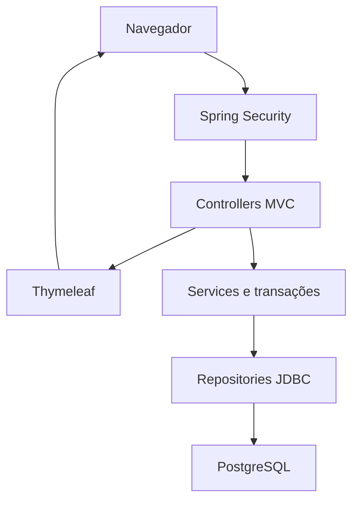
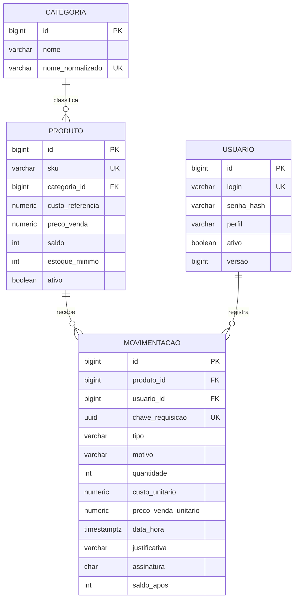

# Arquitetura e decisões

## Responsabilidades

O navegador acessa páginas HTML renderizadas no servidor. Spring Security autentica a sessão e exige ADMIN nas rotas `/admin/**`. Controllers recebem formulários e mostram erros de validação. Services executam regras e transações. Repositories usam JdbcTemplate com parâmetros posicionais. PostgreSQL guarda contas, produtos e histórico.

## Modelo de dados

O script integral está em `src/main/resources/db/migration/V1__estrutura.sql`. O Flyway registra a versão aplicada. Os campos `assinatura`, `saldo_apos` e `usuario.versao` complementam os requisitos: verificam o conteúdo de reenvios, preservam o saldo do comprovante e revogam sessões antigas.

## Transação da movimentação

1. Validar quantidade, motivo, valores e usuário ativo.
2. Obter bloqueio transacional pela chave da solicitação com `pg_advisory_xact_lock`.
3. Se já existir, comparar SHA-256 dos dados normalizados e do autor. Devolver o mesmo registro ou rejeitar conteúdo diferente.
4. Bloquear a linha do produto com `SELECT ... FOR UPDATE OF p`.
5. Conferir produto ativo, saldo disponível e preço de venda atual.
6. Atualizar saldo e último custo, quando entrada. Inserir histórico com custo e preço preservados.
7. Confirmar a transação. Uma exceção desfaz ambas as gravações.

O bloqueio é realizado na mesma ordem em todas as movimentações. A restrição UNIQUE da chave permanece no banco. Duas saídas concorrentes consultam o saldo sob bloqueio, de modo que a segunda observa o resultado da primeira.

Na interface, `POST /movimentos/revisar` mantém um rascunho na sessão. `POST /movimentos/confirmar` aceita somente a chave de um rascunho revisado, e não confia em campos escondidos de quantidade ou valor. Até dez rascunhos ficam disponíveis por sessão, incluindo reenvios recentes. Após expiração, o usuário deve conferir o histórico e abrir outro formulário.

## Histórico e valores

Dinheiro utiliza BigDecimal e NUMERIC(12,2). Quantidades são inteiras. Entradas atualizam o último custo. Vendas usam o preço vigente conferido na confirmação. Perdas usam o custo corrente e exigem justificativa. O valor estimado do estoque não é um cálculo contábil de lucro.

Os valores, o autor, a data, o motivo e as quantidades da movimentação não são editáveis. Um trigger bloqueia UPDATE e DELETE da tabela de histórico. O nome e o SKU exibidos são os atuais do cadastro relacionado; a identificação estável é o ID. Administradores do próprio banco ainda podem alterar a estrutura ou desativar proteções, por isso o acesso direto ao banco deve ficar restrito.

## Acesso e sessão

Senhas usam BCrypt com custo 12. A senha inicial vem de configuração, sem cadastro público. O bootstrap recusa senha vazia e não substitui contas existentes. CSRF protege formulários, inclusive login e logout. A aplicação configura Content Security Policy, usa escape HTML padrão do Thymeleaf e SQL parametrizado. A sessão expira em 30 minutos. A cada requisição autenticada, o sistema verifica o estado e a versão da conta no banco.

A alteração de perfil/ativação utiliza um bloqueio administrativo global, evitando que duas alterações simultâneas removam os dois últimos administradores. O serviço recusa a retirada do último administrador ativo.

## Datas

O banco armazena TIMESTAMPTZ e registra o horário do servidor. A tela converte para America/Sao_Paulo. O filtro usa `data >= início do dia inicial` e `data < início do dia seguinte ao final`, evitando perder registros com segundos fracionários no último dia.

## Operação e limites

A aplicação é um único serviço com banco separado. O Docker Compose facilita a demonstração local; não é evidência de atendimento aos requisitos de DSD. As decisões deste projeto favorecem entendimento de Java, orientação a objetos, transações, SQL e avaliação de qualidade.

Não há exclusão física de cadastros na interface, nem estorno ou correção de estoque. A preservação do histórico torna erros visíveis, mas um processo de ajustes auditáveis deve ser implementado antes de uso comercial que necessite correções. Não utilize reset de carga para corrigir uma loja real.
